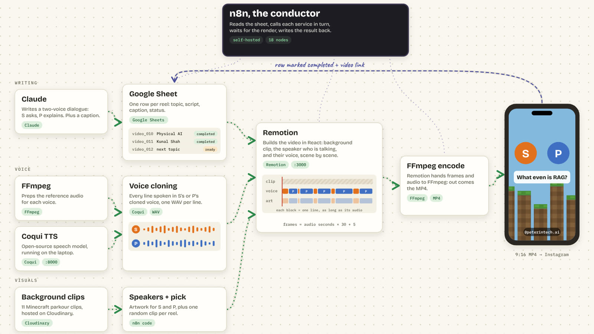
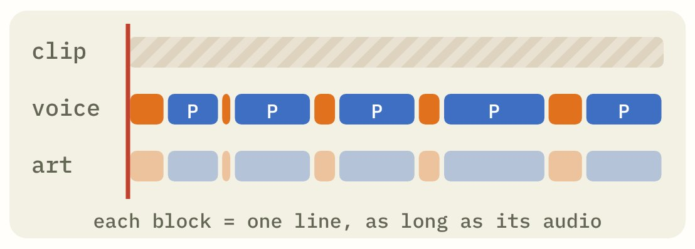

# Brainrot Content Engine

An [n8n](https://n8n.io) workflow that turns one row of a Google Sheet into a "brainrot" tech
explainer reel: two characters chatting in cloned voices over gameplay footage. It powered
[Peter in Tech (@peterintech.ai)](https://www.instagram.com/peterintech.ai/), which rendered 11 reels,
7 of them in under an hour.

> **Status: V1.** This is the first working version, and V2 is in the works.
> Ideas, [issues](https://github.com/thepiyushbansal/brainrot-content-engine/issues) and pull requests are welcome.



[See a reel](https://www.instagram.com/reel/DZwqhuTNVKj/) ·
[Read how it was made](https://piyushbansal.pages.dev/projects/brainrot-pipeline/) ·
[See every n8n step](https://piyushbansal.pages.dev/projects/brainrot-pipeline/n8n.html) ·
[Get the step-by-step PDF](https://piyushbansal.pages.dev/get-workflow/?w=brainrot)

## How it works

| Step | Tools | What happens |
|---|---|---|
| You | Claude, Google Sheets | Pick a topic, have Claude write a two-voice script (S asks, P explains) and paste it into the sheet with status `ready`. |
| 1. Queue | Google Sheets | n8n reads the sheet and takes the first row marked `ready`. One reel per run. |
| 2. Voices | Coqui TTS, FFmpeg | Every line goes to a local Coqui server that speaks it in S's or P's cloned voice. n8n saves each WAV and measures its length. |
| 3. Visuals | any video host | One background gameplay clip is picked at random; the S and P artwork comes along. |
| 4. Render | Remotion | n8n sends the scenes to a local Remotion server. Each scene lasts exactly as long as its audio and shows whoever is speaking. |
| 5. Wait + finish | n8n | n8n waits, checks the render, and keeps checking until it's done. It stops with an error if the render fails, and otherwise writes the video link and `completed` back to the sheet. |

| Cloned voices | One block per line |
|---|---|
|  |  |

## What's in here

```
workflow/brainrot-reel.n8n.json   the n8n workflow (18 steps), ready to import
examples/sheet-template.csv       the sheet's columns, with one example row
examples/script_json-example.json the script format: a list of { "actor": "S" | "P", "text": "..." }
examples/content-log.json         the 11 reels the workflow rendered: topic, length, first lines
media/                            the pictures in this README
```

## Set it up

The workflow is the conductor. It expects three small services running on your computer,
which you bring yourself (any implementation works if it answers the same way):

| Service | Address in the workflow | What it must do |
|---|---|---|
| Voice server (Coqui XTTS) | `POST http://127.0.0.1:8000/generate` | Takes form fields `text` and `actor` (`S` or `P`) and returns a WAV file in that character's voice. |
| Audio file server | `http://127.0.0.1:8080/audio/` | Serves the folder `~/remotion-video/public/audio/`, where n8n saves each line's WAV, so Remotion can read them. |
| Render server (Remotion) | `POST http://127.0.0.1:3000/renders`, `GET http://127.0.0.1:3000/renders/:id` | Takes the payload below and returns an `id`. The status call returns `status` (`completed` or `failed`) and `videoUrl`. |

The payload n8n sends to Remotion:

```json
{
  "scenes": [{ "actor": "S", "text": "…", "audioUrl": "http://127.0.0.1:8080/audio/000_S_….wav", "durationInFrames": 96 }],
  "postCaption": "…",
  "backgroundVideoUrl": "https://YOUR-CDN/clips/parkour-01.mp4",
  "sImageUrl": "https://YOUR-CDN/characters/s.png",
  "pImageUrl": "https://YOUR-CDN/characters/p.png"
}
```

Then:

1. Make a Google Sheet with the columns in `examples/sheet-template.csv`.
2. In n8n: **Import from file** → `workflow/brainrot-reel.n8n.json`.
3. In both Google Sheets steps, choose your Google login and put in your sheet's ID.
4. In **Pick Random Clip + Build Payload**, replace the `YOUR-CDN` links with your clips and character images.
5. The **Save Audio + Compute Duration** step uses Node's `fs`, `path` and `os`, so start n8n with
   `NODE_FUNCTION_ALLOW_BUILTIN=fs,path,os`.
6. Add a row with status `ready` and click **Execute workflow**.

## What's next (V2)

V1 worked, but it wasn't fully hands-off: topics and scripts still went in by hand, and every
service ran on my laptop, so the laptop had to be on for a reel to get made. V2 is about fixing exactly
that, and the channel is on a break until it's ready.

Use voices and characters you have the rights to.

## License

MIT (see `LICENSE`). Made by [Piyush Bansal](https://piyushbansal.pages.dev).
